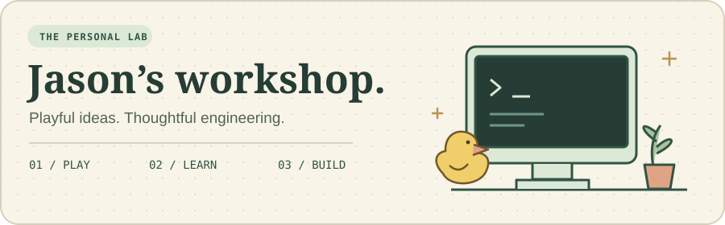

  

  <a href="#play">🕹️ Play</a> &nbsp; · &nbsp;
  <a href="#learn">🔎 Learn</a> &nbsp; · &nbsp;
  <a href="#build">🛠️ Build</a> &nbsp; · &nbsp;
  <a href="#behind-the-builds">☕ Behind the builds</a>

# Hey, I’m Jason.

I build things that are **fun to use and interesting to take apart**.

I’m a backend infrastructure engineer working on AI infrastructure, evaluations, and developer tooling. This is my personal workshop for games, useful tools, and experiments that explain how software works.

**Playful ideas. Thoughtful engineering. Occasionally, a duck.**

---

## 🕹️ Play
**For the joy of making it.**

Games, odd little experiments, and things that make you say “wait, you built that?”

*The arcade shelf is being arranged. Finished experiments will land here.*

<!-- Add a public project here when ready:
### [Project name](PUBLIC_REPOSITORY_OR_DEMO_URL)
One sentence about what someone can do with it.
**Status:** Experimental / Maintained / Complete · **Built with:** language or platform
[Try it](DEMO_URL) · [Code](PUBLIC_REPOSITORY_URL) · [How it works](WRITEUP_URL)
Omit links that do not exist. Never link a private repository here.
-->

## 🔎 Learn
**Open the hood. Bring your curiosity.**

Interactive explanations, small implementations, and notes on the decisions, mistakes, and discoveries behind a build.

*Field notes are on the way. Runnable examples first, big claims later.*

<!-- Add a published explanation or educational project here.
Lead with the question it answers, then link the runnable example and explanation.
-->

## 🛠️ Build
**Small conveniences. Serious foundations.**

Tools for real workflows, developer utilities, and software built to earn a place in someone’s day.

*Useful things are taking shape. I’ll share them when they’re ready to try.*

<!-- Add a public tool here. State the problem it solves, current limitations,
and how to try it. Keep commercial/private work private; link an approved public
case study only when one exists. -->

---

## ☕ Behind the builds

My interests meet somewhere between **backend systems, AI agents, and game mechanics**. I like making complicated behavior easier to see—and building the little tool I wish already existed.

Around here, I aim for:

- **A quick way in.** A demo or an example before a wall of setup.
- **An honest look inside.** Decisions, tradeoffs, and what still breaks.
- **Something worth keeping.** A useful tool, a new idea, or a good time.

Some projects are still on the workbench. This page will grow as I release them.

Built with curiosity. Inspected by a very small duck.

